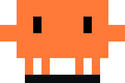
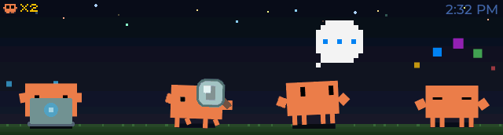
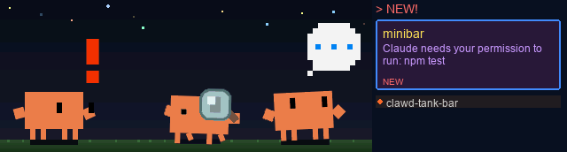

<p align="center">
  
</p>

<h1 align="center">Clawd Tank on the Waveshare bar</h1>

Clawd Tank shows what your Claude Code sessions are doing on a small desk display: one animated pixel-art crab, Clawd, per session, a card for every notification, and a clock. This repository runs it on the [Waveshare ESP32-S3-Touch-LCD-3.49](https://www.waveshare.com/esp32-s3-touch-lcd-3.49.htm) (V2), a 3.49-inch 640 x 172 bar that the firmware drives over Bluetooth LE only. The Python host has been run on Windows, where a tray app can run it for you; its macOS and Linux paths are the original project's. This is a fork of [marciogranzotto/clawd-tank](https://github.com/marciogranzotto/clawd-tank) (MIT), which targets a 320 x 172 ESP32-C6 board and macOS.

<p align="center">
  <br>
  <br>
  <sub>The bar's screen (640 x 172): quiet with four sessions, and a notification arriving. These are reference renders drawn from the firmware's sprite headers and layout rules (the script that draws them is not in this repository), not photographs. The original 320 x 172 simulator recordings are in <code>assets/sim-recordings/</code>.</sub>
</p>

## What is different from the original

- **Board.** ESP32-S3 with an AXS15231B panel over QSPI replaces the ESP32-C6 with an ST7789. The firmware builds for `esp32s3` only; the original board is not supported by this repository.
- **Wide layout.** One build serves two widths and picks the layout at run time from the display width: 640 px gets the wide layout (sixteen stars, sessions spread across the bar, a 180 px notification panel beside a 460 px scene), 320 px keeps the original positions.
- **Art.** Clawd is drawn at 1.5 times the original size in orange (`#EF7D4A` on the panel instead of salmon `#D68263`), rebuilt from the SVGs by `tools/build_bar_sprites.py`. The No connection screen has its own 135 px Clawd.
- **Bar behaviour.** A 12-hour clock, the PWR key switching the screen off and on, and a dimmed instead of dark screen while Clawd sleeps. There is no RGB LED flash: the board has no LED.
- **Windows host.** The hooks reach the daemon over TCP on `127.0.0.1` where Windows has no Unix sockets, and a hook installer asks you to type `yes` before it edits Claude Code's settings. See [host/WINDOWS.md](host/WINDOWS.md).
- **Windows tray app.** `ClawdTank.exe` runs the daemon for you, shows Clawd in the notification area, installs the hooks after you click Yes, and can start with Windows. See [Windows: the tray app](#windows-the-tray-app) and [host/TRAY.md](host/TRAY.md).

## Hardware

- **Board**: [Waveshare ESP32-S3-Touch-LCD-3.49](https://www.waveshare.com/esp32-s3-touch-lcd-3.49.htm) (V2)
- **MCU**: ESP32-S3R8, dual core up to 240 MHz, 16 MB flash, 8 MB octal PSRAM
- **Display**: 3.49" IPS, 172 x 640 portrait (drawn here as 640 x 172 landscape), AXS15231B over QSPI
- **Connectivity**: Bluetooth LE (NimBLE, peripheral role). The firmware never starts Wi-Fi.
- **Keys**: BOOT (clears notifications), PWR (screen off and on), RESET
- **Power**: USB-C, or a lithium battery (Waveshare sells the board in two case styles, each with or without a battery). On battery the board switches itself off when PWR is released unless the firmware holds the power, so `app_main` does that first, through the I/O expander.
- **Not used**: the touch panel, RTC, IMU and audio codec on the board.

The original board, the ESP32-C6-LCD-1.47 (320 x 172 ST7789, WS2812 LED), is supported by [the upstream repository](https://github.com/marciogranzotto/clawd-tank), not by this one.

## How it works

```
Claude Code hook --> clawd-tank-notify --> daemon --Bluetooth LE--> the bar
                      one JSON line        per-session state        NimBLE -> LVGL
```

1. **Claude Code runs the notify script** for 13 hook events: `SessionStart`, `UserPromptSubmit`, `PreToolUse`, `PostToolUse` (scoped to `AskUserQuestion`), `PermissionRequest`, `PostToolUseFailure`, `PreCompact`, `Stop`, `StopFailure`, `Notification` (scoped to `idle_prompt`), `SubagentStart`, `SubagentStop` and `SessionEnd`.
2. **The script** turns the hook payload into one line of JSON, adds the PID of the Claude Code process when it can find it, and sends it to the daemon: over a Unix socket (`~/.clawd-tank/sock`) on macOS and Linux, or over TCP on `127.0.0.1:47421` on Windows. It never fails a hook: if nobody is listening it exits quietly (the TCP connect gives up after 0.3 s).
3. **The daemon** keeps the state of every session (thinking, working with a tool, waiting for you, confused, error, idle), saves it to `~/.clawd-tank/sessions.json`, and drops a session when its Claude process is gone (checked every 30 s, if the PID is known) or after 600 s without an event (a session that is waiting for you is kept). From that it works out what the bar should show: up to four animations, a sub-agent count and an overflow count, or "sleeping" when no session is left.
4. **Over Bluetooth LE** it writes JSON to the bar's notification characteristic: `add` and `dismiss` for cards, `set_sessions` or `set_status` for the scene, `set_time` on every connect. It scans for a device named `Clawd Tank`, probes the link every 20 s, and replays the active cards and the scene after a reconnect. See [BLE interface](#ble-interface).
5. **The firmware** receives the writes in a NimBLE GATT server, queues them as events and renders everything with LVGL.

| Hook | What the bar does |
|------|-------------------|
| `SessionStart` | the session gets a Clawd, idle; from the second session on it walks in from the right and the others slide into new lanes |
| `UserPromptSubmit` | thinking; the session's card, if any, is dismissed |
| `PreToolUse` | the tool's animation (table below); `AskUserQuestion` shows the alert instead |
| `PostToolUse` (`AskUserQuestion` only) | the alert ends, back to thinking |
| `PermissionRequest` | alert (Claude is waiting for you) |
| `PostToolUseFailure` | confused |
| `PreCompact` | a one-shot sweeping animation on that session |
| `Stop` | a "Waiting for input" card for the project; the session goes idle |
| `StopFailure` | a card with the error text; dizzy |
| `Notification` (`idle_prompt`) | a card with Claude's message; confused |
| `SubagentStart`, `SubagentStop` | conducting while sub-agents run, plus the sub-agent counter |
| `SessionEnd` | its Clawd burrows away and its card is dismissed |

## Getting started

### 1. Build and flash the firmware

You need [ESP-IDF 5.4.2](https://docs.espressif.com/projects/esp-idf/en/v5.4.2/esp32s3/get-started/index.html) installed and exported in your shell (the component manifest requires 5.4 or newer). The first configure downloads LVGL 9.5 and the AXS15231B driver, so it needs internet access.

```bash
cd firmware
idf.py set-target esp32s3
idf.py build
idf.py -p <port> flash monitor
```

The board's USB-C socket is the ESP32-S3's USB Serial/JTAG port, which is also the log console. The partition table (`firmware/partitions.csv`) has no OTA slot:

| Offset | Content | Written by |
|--------|---------|-----------|
| `0x0` | bootloader | `idf.py flash` |
| `0x8000` | partition table | `idf.py flash` |
| `0x9000` | `nvs`, 24 KB: saved brightness and sleep timeout | never; `idf.py erase-flash` clears it |
| `0xf000` | `phy_init`, 4 KB | never |
| `0x10000` | `factory` app, `0xFF0000` bytes, to the end of the 16 MB | `idf.py flash`, or `idf.py app-flash` for the app alone |

Neither flash command touches `nvs`, so the saved settings survive a reflash. A build from the committed sources (ESP-IDF 5.4.2, LVGL 9.5.0, `esp_lcd_axs15231b` 1.0.1) is `clawd-tank.bin` of 2,624,208 bytes (`0x280AD0`), which leaves `0xD6F530` bytes, 84 %, of the app partition free.

Options in `idf.py menuconfig` under "Clawd Configuration":

- `CLAWD_LCD_TURN_180` (default off) turns the picture by 180 degrees if it comes up upside down.
- `CLAWD_SLEEP_BRIGHTNESS` (0 to 255, default 20) is the backlight level while Clawd sleeps; 0 switches the screen off as the original does.
- `CLAWD_WIFI_ENABLED` is left over from the original; nothing reads it.

Status on the hardware: the panel, its orientation, the backlight, the wide layout and the Bluetooth link to the daemon run as built. The PWR key's screen toggle is in the image but has not been confirmed by hand yet.

### 2. Run the host daemon

The host needs Python 3.10 or newer and [bleak](https://github.com/hbldh/bleak) (`rumps` is installed on macOS only). On Windows use the `py` launcher (`py -3`) where this says `python`.

```bash
cd host
python -m venv .venv
. .venv/bin/activate          # Windows PowerShell: .venv\Scripts\Activate.ps1
pip install -r requirements.txt
python -m clawd_tank_daemon
```

Leave it running; `Ctrl+C` clears the bar and stops it. The daemon scans for the bar, connects and syncs the clock. The bar takes one connection at a time, so close any other app that is connected to it. Windows needs no pairing. Useful options: `--log-file PATH`, `--debug`, `--transport {auto,unix,tcp}`, `--tcp-port N`.

How the hooks find the daemon is set by three environment variables, read by the daemon and by the notify scripts, so set them for both:

| Variable | Default | Meaning |
|----------|---------|---------|
| `CLAWD_TANK_TRANSPORT` | `auto` | `unix` where Unix sockets exist, `tcp` on Windows; `tcp` forces TCP anywhere |
| `CLAWD_TANK_TCP_PORT` | `47421` | TCP port on `127.0.0.1` |
| `CLAWD_TANK_SOCKET` | `~/.clawd-tank/sock` | Unix socket path |

Windows details (log lines to expect, troubleshooting, what is not available) are in [host/WINDOWS.md](host/WINDOWS.md). It was written for Windows 11 with Python 3.10 and bleak 3.0.2. macOS and Linux are upstream's code paths and have not been run on this board.

### 3. Install the hooks

```bash
python -m clawd_tank_daemon.install_hooks --print    # show what would change; writes nothing
python -m clawd_tank_daemon.install_hooks            # asks you to type yes first
```

The installer prints the `hooks` block and the settings file it would edit (`~/.claude/settings.json`, or `$CLAUDE_CONFIG_DIR/settings.json`), and writes only after you type `yes` in a terminal; there is no flag that skips the question. It then writes the notify script to `~/.clawd-tank/` (`clawd-tank-notify.py` on Windows, `clawd-tank-notify` elsewhere), saves a timestamped backup of your settings, and merges the 13 hooks in, keeping your other settings and hooks. Running it again changes nothing, and a `settings.json` that is not valid JSON is refused. On Windows each hook is `py -3` followed by the quoted path of `clawd-tank-notify.py` in `%USERPROFILE%\.clawd-tank\`, written with forward slashes so it works from Git Bash, PowerShell and cmd. Restart running Claude Code sessions afterwards, because hooks are read at startup.

The installed notify script never starts the daemon, so start it yourself (step 2, or use the [tray app](#windows-the-tray-app), which runs it). The repository's own `host/clawd-tank-notify` does start it on the first hook, with whichever Python runs it, which then needs bleak.

The installer's code is platform neutral and is documented for macOS and Linux too, but it has only been run on Windows here. On macOS the upstream menu bar app installs the same hooks (see [From upstream](#from-upstream)). Do not use `host/install-hooks.sh` from upstream: it registers three hooks, not thirteen.

To check the result, start a new Claude Code session and send a prompt. Clawd should switch to thinking and then to a tool animation, and the daemon log shows a `Socket msg:` line for every hook and a `Display:` line whenever the scene changes.

### Windows: the tray app

On Windows, `ClawdTank.exe` can replace steps 2 and 3. It runs the daemon in the background, installs the hooks when you click Yes in a dialog (the same consent as typing `yes`, with the same backup of `settings.json`), and can start with Windows. Its icon is one still Clawd in the notification area: orange when the bar is connected, grey while it looks for the bar, and with a red dot when another daemon holds port 47421. A click on the icon opens a small flyout with the state of the bar, the hooks and your sessions, and rows to install or remove the hooks, open the log, start with Windows or quit; a right-click opens a menu with the same actions. Unlike the terminal daemon, it keeps a session on the bar for as long as its Claude Code process runs, however long the session has been idle.

This repository publishes no build, so build one (Python 3.10 or newer with the `py` launcher):

```powershell
powershell -File host\tray\build-tray.ps1
```

The result is `host\tray\dist\ClawdTank\ClawdTank.exe`; keep its folder together. The exe is not code-signed, so SmartScreen asks you to click More info, then Run anyway. Close any terminal daemon first, because only one daemon can hold the bar. How the flyout opens and closes, the files and settings it uses, how to uninstall it and its known limits are in [host/TRAY.md](host/TRAY.md).

## Screens and behaviour

**Quiet** (connected, no card waiting). The scene is the full 640 px: sky gradient, grass, sixteen twinkling stars, one Clawd per session (up to four). The clock is top right, in 12-hour form (`2:32 PM`), set from the host's time and time zone on every connect. A mini-crab counter with `xN` at the top left shows running sub-agents. More than four sessions add a `+N` badge, 6 px left of the clock. Clawds stand in equal lanes spread 20 px further apart, but no centre is nearer than 64 px to an edge:

| Sessions | Centres, quiet (640 px) | Centres beside the panel (460 px) |
|----------|-------------------------|-----------------------------------|
| 1 | 320 | 230 |
| 2 | 150, 490 | 105, 355 |
| 3 | 87, 320, 553 | 64, 230, 396 |
| 4 | 65, 235, 405, 575 | 64, 230, 396, and the fourth is hidden |

**Notification panel.** A new card narrows the scene to 460 px over 400 ms and fades in the 180 px panel at x 460; the clock is hidden meanwhile. At most three sessions stay visible (lanes of at least 140 px, `LANE_MIN_PX`); when one is hidden, a badge `xN` at the scene's right edge counts all sessions. In the panel:

- A header at (4, 2): `> NEW!` for the hero moment, then `> N WAITING!`.
- A featured card at (4, 22), 171 px wide: project name, then the message wrapped to two lines (one when collapsed, with an ellipsis if it still overflows), then a badge.
- The hero moment holds for 2.5 s with an 80 px card (badge `NEW`) and up to three 14 px rows below it from y 108, then collapses over 350 ms to a 64 px card with up to five rows from y 90.
- With several cards the featured one rotates every 8 s; the badge reads `NEWEST` or `i/n`. The bar keeps eight cards and drops the oldest for a ninth. Project names are cut at 31 characters and messages at 63.

**No connection.** Shown at power-on and whenever the link drops (the cards are cleared): a 135 px Clawd (arm to arm, in a 278 x 164 frame) with a question mark and a Bluetooth bubble, and the label "No connection" at the top centre.

**Sleeping.** When the daemon reports no session, Clawd sleeps and the backlight drops to `CLAWD_SLEEP_BRIGHTNESS` (20 of 255 by default, never above the configured level). Through the brightness curve in `display.c` that is about 21 % of full LED current, against about 41 % at the default level of 102. The next session wakes it. If the link drops while Clawd sleeps, the configured brightness comes back so that No connection is visible.

**Keys.** BOOT (GPIO 0) clears all cards and returns to the quiet screen. PWR (GPIO 16) switches the screen off, and on again at the last level; while it is off, activity keeps updating the scene but never lights the backlight. Each key has a 200 ms debounce.

**Brightness** is 0 to 255, default 102, saved in `nvs`, and set by writing to the config characteristic (see below); 0 is fully dark. The Windows host has no control for it, so use a BLE tool.

### Animations

| Animation | Shown when | Size (px) |
|-----------|------------|-----------|
| idle | a session has started, or Claude has stopped | 108 x 77 |
| thinking | a prompt was submitted | 114 x 138 |
| typing | `Edit`, `Write`, `NotebookEdit`, and any tool not listed here | 130 x 117 |
| debugger | `Read`, `Grep`, `Glob` | 130 x 65 |
| building | `Bash` | 186 x 113 |
| conducting | `Agent`, or sub-agents running | 114 x 118 |
| wizard | `WebSearch`, `WebFetch` | 106 x 195 |
| beacon | `LSP` and `mcp__*` tools | 200 x 190 |
| alert | Claude waits for you: a permission request or `AskUserQuestion`; also plays once on a new card | 178 x 148 |
| confused | an idle prompt, or a tool failure | 228 x 170 |
| dizzy | `StopFailure`, an API error | 136 x 108 |
| sweeping | context compaction, once, on the compacting session | 210 x 84 |
| walking, going away | a session arrives, a session ends | 90 x 60, 254 x 91 |
| sleeping | no session | 138 x 144 |

The ground line of every sprite is 8 px above the bottom edge (`y_offset` in `scene.c`). All sprites fit the 172 px height except the wizard's sparkles, which run up to 31 px off the top, and the beacon's rings, 6 px off the top and 12 px below the bottom. The four everyday working sprites (typing, debugger, thinking, conducting) are at most 130 px wide, so four fit the 160 px quiet lanes and three fit the 140 px lanes beside the panel. Going away, confused, sweeping, beacon, building and alert are wider than a lane and can overlap a neighbour while they play. `happy` is still in the firmware but nothing plays it, and `juggling` only appears for the older `set_status` value `working_2`.

## BLE interface

The bar advertises as `Clawd Tank` and accepts one connection (advertising restarts after a disconnect). The GATT service is `AECBEFD9-98A2-4773-9FED-BB2166DAA49A`, with no encryption required:

| Characteristic | UUID | Access | Content |
|----------------|------|--------|---------|
| Notification | `71FFB137-8B7A-47C9-9A7A-4B1B16662D9A` | write, write without response | one JSON object, up to 512 bytes |
| Config | `E9F6E626-5FCA-4201-B80C-4D2B51C40F51` | read, write | `{"brightness": 0-255, "sleep_timeout": 0-3600}` |
| Version | `B6DC9A5B-5041-4B32-9F8D-34321DF8637C` | read | `"2"` |

`sleep_timeout` is stored but the firmware does not act on it. The notification actions:

| `action` | Fields | Effect |
|----------|--------|--------|
| `add` | `id`, `project`, `message`, optional `alert: "error"` | add or update a card |
| `dismiss` | `id` | remove a card |
| `clear` | none | remove all cards |
| `set_time` | `epoch`, `tz` (POSIX, such as `UTC+4`) | set the clock |
| `set_sessions` | `anims`, `ids`, `subagents`, `overflow` | the scene: up to four animations (`idle`, `alert`, `typing`, `thinking`, `building`, `confused`, `sweeping`, `dizzy`, `debugger`, `wizard`, `conducting`, `beacon`) with stable numeric ids |
| `set_status` | `status` | the older single-Clawd scene: `sleeping`, `idle`, `thinking`, `working_1` to `working_3`, `confused`, `sweeping` |

`alert: "error"` only drove the original board's LED, so it changes nothing on screen here. [docs/protocol-changelog.md](docs/protocol-changelog.md) records how version 2 differs from version 1; its list of animation names is out of date.

## The sprite pipeline

The firmware's sprites are C headers of RLE-compressed RGB565 frames in `firmware/main/assets/`, generated from the animated SVGs in `assets/svg-animations/` (the original art; the bar's No connection screen is `assets/svg-animations/bar/clawd-disconnected-bar.svg`). Regenerate them, do not edit them:

```bash
pip install playwright pillow numpy && python -m playwright install chromium
python tools/build_bar_sprites.py --install
```

For each of eighteen animations the script renders PNG frames with `tools/svg2frames.py` (headless Chromium), repaints Clawd's body with `tools/clawd_recolour.py` (props and eyes stay), converts to RGB565 with `tools/png2rgb565.py` and crops with `tools/crop_sprites.py`. The HUD's small crab (`sprite_mini_crab.h`) is recoloured from `tools/upstream_sprites/`, so a rebuild never recolours a recolour. Options:

| Option | Default | Meaning |
|--------|---------|---------|
| `--scale` | 6 | pixels per SVG unit (the original used 4) |
| `--disconnected-scale` | 6 | the same for the No connection screen, whose SVG is laid out in screen pixels |
| `--colour` | `#F17D4A` | body colour; RGB565 shows the nearest value, `#EF7D4A`; `none` keeps the original salmon |
| `--only a,b` | all | rebuild only these sprites |
| `--out DIR`, `--work DIR` | | write headers elsewhere than `firmware/main/assets`, and keep scratch files elsewhere |

`--colour none` does not undo the No connection screen (it always uses the bar's SVG) and leaves the small crab as it is. After a rebuild the script prints how many bottom rows each sprite lost to cropping; `y_offset` in `scene.c` follows the rule in the comment above `anim_defs` and is edited by hand. Rebuilding the typing, walking and No connection sprites and the small crab with these defaults reproduces the shipped headers byte for byte. The 19 RLE headers (the animations and the small crab) total 26.2 MB of raw RGB565 and 1.68 MB as RLE (about 16:1), roughly 0.54 MB more than the original sprites. Decoded, a frame takes three bytes a pixel (RGB565A8) and is held in PSRAM: the largest, the No connection Clawd, is 134 KiB.

## From upstream

These parts come from the original project. They are still in the repository, and none has been exercised on this board.

- **Simulator** (`simulator/`): a native SDL2 build of the UI code that the daemon can drive over TCP (`--listen`, port 19872, with the daemon's `--sim` or `--sim-only`) or that scenario files can script. It is fixed at 320 x 172, so it shows the original layout with this fork's larger sprites, which have not been retuned for it; its clock is 24-hour. It needs LVGL in `firmware/managed_components/`, which configuring the firmware once creates. Not built here. See [simulator/README.md](simulator/README.md). `tools/record_gif.py` records GIFs from its binary; the GIFs in `assets/sim-recordings/` are the original project's recordings, with the original sprites.
- **macOS menu bar app** (`host/clawd_tank_menubar/`): run it from source with `python -m clawd_tank_menubar` in `host/`, or build the `.app` with `host/build.sh` (it expects a `host/.venv` with py2app and builds the static simulator first). It runs the daemon with BLE and simulator transports and offers a brightness slider, a session-timeout picker, an install-hooks item and launch at login; it logs to `~/Library/Logs/ClawdTank/`. Not run here. On Windows the [tray app](#windows-the-tray-app) plays that part; it and the menu bar app both use the hook-installer logic in `hooks.py`.
- **BLE debugging** (`tools/ble_interactive.py`, whose keys are listed in its help text, and `tools/ble_test.py`, a scripted add-and-dismiss run): both use the UUIDs above and need the daemon stopped, because the bar takes one connection. Not run here. `ble_interactive.py` imports `termios`, so it does not run on Windows.

## Project layout

| Path | Content |
|------|---------|
| `firmware/main/` | firmware: `ble_service.c` (GATT), `display.c`, `board_exio.c`, `board_pins.h`, `board_lv_mem.c` (panel, expander, pins, LVGL memory), `layout.h`, `scene.c`, `notification_ui.c`, `ui_manager.c` (UI), `button.c`, `config_store.c`, `notification.c`, `rgb_led.c` (a no-op on the device) |
| `firmware/main/assets/` | generated sprite headers |
| `firmware/` | `sdkconfig.defaults`, `partitions.csv`, `main/idf_component.yml`, `main/Kconfig.projbuild` |
| `firmware/test/` | host-side C tests |
| `host/clawd_tank_daemon/` | the daemon: BLE client, hook transport, socket server, session state, protocol, `install_hooks.py` |
| `host/clawd-tank-notify` | the repository's hook script, which can start the daemon |
| `host/WINDOWS.md` | the Windows guide |
| `host/clawd_tank_tray/`, `host/tray/` | the Windows tray app, and its build (PyInstaller spec, `build-tray.ps1`, `make_icons.py`) |
| `host/TRAY.md` | the tray app guide |
| `host/tests/` | the host tests |
| `host/clawd_tank_menubar/`, `host/build.sh`, `host/setup.py`, `host/launcher.py` | the macOS menu bar app and its build (upstream) |
| `host/install-hooks.sh` | upstream's `jq` installer, which is out of date |
| `simulator/` | the SDL2 simulator (upstream) |
| `tools/` | `build_bar_sprites.py`, `clawd_recolour.py`; the original pipeline `svg2frames.py`, `png2rgb565.py`, `crop_sprites.py`, `analyze_sprite_bounds.py`; `record_gif.py`; the BLE scripts; `gemini_animate.py` (writes SVGs with the Gemini CLI), `svg2slack_emoji.py`, `slack_emoji_upload.py`, `scene-layout-editor.html`, `sprite-designer/`, `direnv_src.sh` |
| `assets/` | `svg-animations/`, the original recordings and screenshots, Slack emoji, app icons |
| `docs/bar/` | the reference renders; only `mock-wide.png`, `mock-notification-wide.png` and `mock-disconnected.png` match the current layout |
| `docs/` | `protocol-changelog.md`; `superpowers/` and `pr-analysis/` are the original project's plans, specs and reviews |

`CHANGELOG.md`, `CLAUDE.md`, `GEMINI.md`, `TODO.md`, `setup_env.sh` and `.github/` come from the original project and describe the ESP32-C6 board; they have not been updated for this fork.

## Tests

```bash
# Python: daemon, hook transport, installer, protocol, tray app
cd host && pip install -r requirements-dev.txt pystray pillow && python -m pytest

# C: notification store, config store, RLE decoder (gcc and make)
cd firmware/test && make test
```

The host suite has 913 tests. On Windows 11 with Python 3.10.11, bleak 3.0.2, pystray 0.19.5 and Pillow 12.3.0, 882 pass and 31 are skipped with a reason (24 need Unix sockets, one needs macOS's `NSBundle`, one checks a non-Windows answer, four need `ClawdTank.exe` to be built, one needs a working Tk; TCP and Windows tests cover the same ground). The tray tests (`tests/test_tray_*.py` and `tests/test_daemon_embedded.py`) import pystray and Pillow, so without them five test files fail to import. The suite has not been run on macOS or Linux, and no test talks to a real radio: BLE is faked. The C tests are 11 for the notification store, 7 for the config store and 5 for the RLE decoder. `make test` builds them with AddressSanitizer and UndefinedBehaviorSanitizer; on Windows the three programs were built with MinGW-w64 gcc 16.1 without the sanitizers and pass, with `-Wno-unused-variable` added for `test_config_store`, where `-Werror` rejects an unused `TAG` in `config_store.c`. The layout code (`scene.c`, `notification_ui.c`, `ui_manager.c`), the display driver and the BLE service have no automated tests; they are checked by running on the bar.

## Credits and licence

- **Original project**: [marciogranzotto/clawd-tank](https://github.com/marciogranzotto/clawd-tank), MIT. The animated Clawd art, the hook-to-animation state model, the daemon and protocol design, the simulator and the macOS menu bar app are its work; this repository rescales and recolours the art and adapts the rest.
- **Board bring-up**: adapted from the author's own firmware for the same board (the source comments call it the MiniBar project), which follows Waveshare's ESP-IDF examples for the V2 board (`10_LVGL_V9_Test`, `11_FactoryProgram`, `07_BATT_PWR_Test`) and its schematic. That covers the expander driver and power hold, the panel reset and init sequence, the QSPI settings, the chunked flush, the backlight PWM and brightness curve, the pin map, the PSRAM allocation of LVGL's memory and the chip settings in `sdkconfig.defaults`.
- **Panel driver**: Espressif's `esp_lcd_axs15231b` (Apache-2.0), fetched by the component manager, not vendored.
- **LVGL** 9.5 (MIT), fetched by the component manager.
- **Tray app**: Clawd's icons are made from the original project's sprite (its MIT notice is kept in [host/tray/LICENSE-clawd-tank.txt](host/tray/LICENSE-clawd-tank.txt)); it uses [pystray](https://github.com/moses-palmer/pystray) and [Pillow](https://python-pillow.org), and is packaged with PyInstaller. The header image at the top of this file is the same Clawd.
- **Bundled in `simulator/`**: cJSON (Dave Gamble and contributors, MIT) and stb_image_write (public domain or MIT).

This repository is under the MIT licence, in [LICENSE](LICENSE), which carries the original notice: `Copyright (c) 2026 Marcio Granzotto Rodrigues`.
